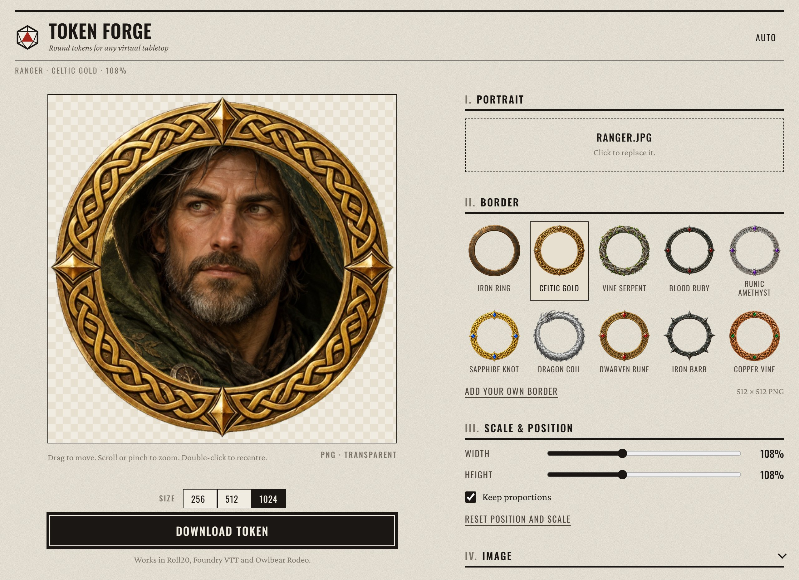

# Token Forge

Make round tokens for virtual tabletops in your browser. Pick a border, frame a portrait, and download a transparent PNG for Roll20, Foundry VTT, Owlbear Rodeo or any VTT that takes images.

**[Open Token Forge](https://tokenforge.dungeongadgets.com/)** · No account, no upload: images never leave your browser.

[](CHANGELOG.md)
[](LICENSE)
[](https://tokenforge.dungeongadgets.com/)



## Features

- **Portraits:** upload, drop or paste (Ctrl+V) a PNG, JPG or WEBP.
- **10 borders:** Iron Ring, Celtic Gold, Vine Serpent, Blood Ruby, Runic Amethyst, Sapphire Knot, Dragon Coil, Dwarven Rune, Iron Barb and Copper Vine.
- **Custom borders:** load your own 512×512 PNG. The opening is detected automatically.
- **Framing:** drag to move, scroll or pinch to zoom, double-click to recentre. Width and height scale separately when you need to stretch.
- **Adjustments:** brightness, contrast, saturation, flip and free rotation.
- **Safe-area ring:** shows exactly where the portrait is cut.
- **Export:** transparent PNG at 256, 512 or 1024 px. Larger sizes are redrawn from the source image, not upscaled.
- **Keyboard:** arrow keys nudge (Shift for bigger steps), + and − zoom.
- **Light and dark themes**, and your settings are remembered between visits.

## Running locally

No build step and no dependencies. Clone the repo and serve the folder:

```bash
git clone https://github.com/Sectr99/TokenForge.git
cd TokenForge
npm start
```

Then open http://localhost:3000. `npm start` runs [`serve`](https://www.npmjs.com/package/serve) through `npx`; any static file server works.

## How it works

Everything runs client-side on a single `<canvas>`. The portrait is clipped to a circle at the border's inner radius, transformed and filtered, and the border image is drawn on top. Exports redraw the same scene on an offscreen canvas at the chosen size.

```
index.html          page shell
css/main.css        styles (DungeonTools design tokens and components)
js/borders.js       built-in border list: image path and cut radius
js/app.js           canvas rendering, input handling, export, saved settings
assets/borders/     border art (512×512 WebP with alpha)
```

### Adding a built-in border

1. Add a 512×512 image with a transparent background and a fully opaque ring to `assets/borders/`.
2. Add an entry to `BORDERS` in `js/borders.js`. `innerR` is the radius in pixels, from the centre, where the portrait is cut. Set it a few pixels past the ring's inner edge so the portrait tucks under it.

## Deployment

Hosted on Cloudflare. Pushes to `main` deploy the repository root as static assets (see `wrangler.jsonc`); cache headers are in `_headers`. JS and CSS are cached for a year, so bump the `?v=` query in `index.html` when they change.

## Roadmap

- Colour tint per border
- Creature size presets (Small, Medium, Large, Huge)
- Name label under the token
- Batch export

## License

[MIT](LICENSE). Part of [Dungeon Gadgets](https://dungeongadgets.com/), tools for running tabletop games.
